# Predição de Atropelamentos e Identificação de Hotspots de Fauna Silvestre com Redes Neurais

**Universidade Federal de Santa Maria — Disciplina de Inteligência Artificial**
**Trabalho de Aprendizado Supervisionado**
**Integrantes:** Bruna Caetano, Inácio Boemo e Lucas Aued

---

## Sumário

1. Descrição do problema e dos dados
2. Etapa 1 — Análise exploratória
3. Engenharia de atributos e definição dos problemas
4. Etapa 2 — Pré-processamento e divisão dos dados
5. Etapa 3 — Classificação com MLP (binária e multiclasse)
6. Etapa 4 — Regressão com MLP
7. Etapa 5 — Otimização de hiperparâmetros com Optuna
8. Etapa 6 — Regularização e overfitting
9. Etapa 7 — Discussão final
10. Reprodução dos experimentos

---

## 1. Descrição do problema e dos dados

O Projeto RodoFauna (IBRAM/DF) realizou, entre abril de 2010 e março de 2015, percursos sistemáticos em rodovias do Distrito Federal registrando animais atropelados, com identificação taxonômica e coordenadas UTM (fuso 23S). O objetivo deste trabalho é construir um pipeline de aprendizado supervisionado que:

- **classifique** trechos rodoviários quanto à ocorrência de atropelamentos de fauna silvestre (problema binário — base para identificar *hotspots*);
- **classifique** o grupo taxonômico do animal atropelado (aves, mamíferos, répteis, anfíbios — problema multiclasse);
- **estime** o número de atropelamentos por trecho e mês (regressão).

Todos os experimentos usam apenas registros de **fauna silvestre**. Conforme o enunciado, `id`, `silvestre_`, `hora`, `sexo`, `posicao`, `ordem`, `familia`, `nome_popul`, `campanha` e `periodo` **não** foram usados como preditores; `mes` foi substituído por atributos derivados de `data_dt`. `classe` foi usada apenas como alvo, e `especie_nm` não foi usada como entrada.

Tudo foi implementado em Python com scikit-learn (MLPClassifier/MLPRegressor) e Optuna no arquivo `trabalho.py`. Todas as figuras estão em `figuras/`, as tabelas em `resultados/` e a saída completa da execução em `resultados/saida.txt`.

---

## 2. Etapa 1 — Análise exploratória

### 2.1 Visão geral

| Item | Valor |
|---|---|
| Linhas no arquivo original | 10.328 |
| Linhas após remover duplicatas | **5.164** |
| Registros de fauna silvestre | **4.422** (742 domésticos descartados) |
| Atributos originais | 19 (+ `OBJECTID`) |
| Período | 05/04/2010 a 30/03/2015 (483 datas de percurso) |
| Valores ausentes (NaN) | 0 |

**Duplicatas:** cada `id` aparece exatamente duas vezes no arquivo, com todos os campos idênticos (exceto `OBJECTID`). Os registros duplicados foram removidos — mantê-los dobraria artificialmente as contagens e colocaria cópias idênticas em treino e teste.

**Tipos:** inteiros (`id`, `campanha`, `ano`, `periodo`, `x`, `y`) e texto/categóricos (`mes`, `data_dt`, `dia_da_sem`, `silvestre_`, `classe`, `ordem`, `familia`, `especie_nm`, `nome_popul`, `uc`, `posicao`, `hora`, `sexo`).

### 2.2 Valores ausentes e `nao_identificado`

Não há NaN, mas a ausência de informação está codificada como `nao_identificado`:

| Atributo | % `nao_identificado` (silvestres) |
|---|---|
| sexo | 96,2 % |
| posicao | 52,6 % |
| hora | 37,6 % |
| especie_nm | 22,6 % |
| familia | 19,0 % |
| ordem | 3,9 % |
| nome_popul | 1,8 % |

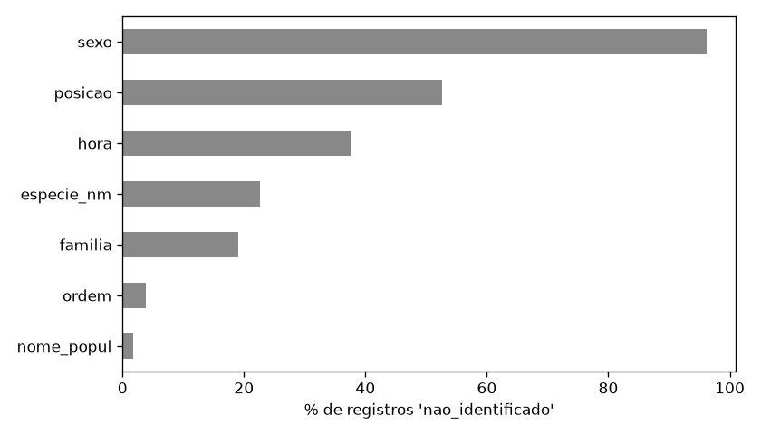

`sexo`, `posicao` e `hora` são praticamente inutilizáveis (e também proibidos pelo enunciado). `especie_nm` tem 22,6 % de registros não identificados, o que reforça a escolha de **classe** (apenas 1 registro não identificado) como alvo multiclasse. Foram corrigidas pequenas inconsistências: `dia_da_sem = "eg_"` (erro de digitação de `seg`) e uma grafia alternativa de `nao_identificado` em `sexo`.

### 2.3 Distribuição das classes

| Classe | Registros | % |
|---|---|---|
| aves | 3.008 | 68,1 % |
| répteis | 690 | 15,6 % |
| mamíferos | 447 | 10,1 % |
| anfíbios | 274 | 6,2 % |

O desbalanceamento é forte (razão ≈ 11:1 entre aves e anfíbios). Por espécie a situação é pior: 180 espécies, só **23 com ≥ 30 registros** e 54 com um único registro; uma só espécie (*Volatinia jacarina*, tiziu) concentra 1.221 registros. Por isso a classificação multiclasse foi feita por grupo taxonômico, como recomendado no enunciado.

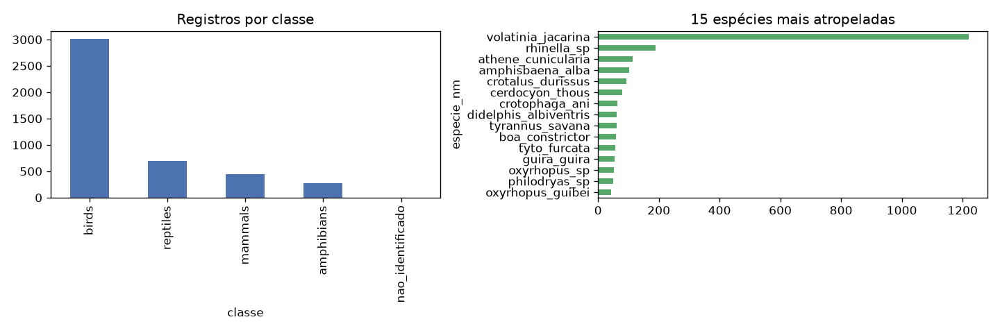

### 2.4 Estatísticas descritivas e redundância

| | ano | campanha | periodo | x | y |
|---|---|---|---|---|---|
| média | 2012,3 | 242,7 | 2,9 | 199.824 | 8.261.913 |
| desvio | 1,4 | 132,1 | 1,4 | 18.857 | 17.371 |
| mín | 2010 | 1 | 1 | 168.694 | 8.230.610 |
| máx | 2015 | 484 | 5 | 228.478 | 8.282.622 |

`ano`, `campanha` e `periodo` são quase colineares (correlações de 0,94 a 0,98): codificam o mesmo eixo temporal, o que justifica descartar `campanha`/`periodo`. O campo `dia_da_sem` concorda com o dia derivado de `data_dt` em 99,4 % dos casos; usamos o dia derivado da data. **Não existem registros em sábados ou domingos** (os percursos ocorriam em dias úteis), portanto o atributo "final de semana" sugerido no enunciado é constante e foi descartado.

As coordenadas não têm outliers (todas caem sobre as rodovias monitoradas). Os outliers relevantes estão nas **contagens por trecho**: 10 células de 500 m têm total acima de Q3 + 1,5·IQR — são exatamente os *hotspots* que queremos identificar, não erros, e por isso não foram removidos.

### 2.5 Distribuição espacial

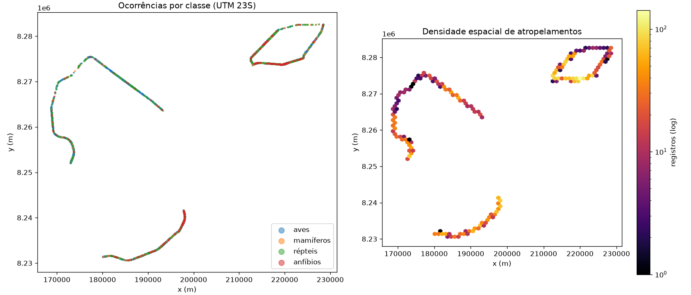

Os registros seguem quatro trechos rodoviários, associados às unidades de conservação ESECAE (2.024 registros), PNB (1.257) e JBB/FAL/IBGE (1.139). A densidade não é uniforme: há trechos com mais de 100 registros por hexágono e trechos quase vazios — ou seja, existem hotspots espaciais claros.

### 2.6 Distribuição temporal

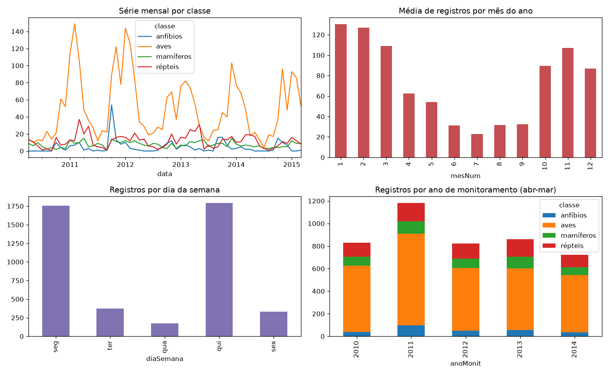

Há forte **sazonalidade**: os meses chuvosos (out–mar) concentram a maior parte dos atropelamentos, com pico em novembro–fevereiro; junho–agosto (seca) têm os menores valores. Répteis e anfíbios acompanham a estação chuvosa de forma ainda mais acentuada. O esforço de amostragem é estável (6 a 10 dias de percurso por mês, média 8,1), o que permite comparar meses entre si. Por ano de monitoramento (abr–mar): 831, 1.181, 823, 863 e 724 registros.

---

## 3. Engenharia de atributos e definição dos problemas

### 3.1 Unidade espacial: células de 500 m

Não há geometria das rodovias na base, então a malha rodoviária foi discretizada em **células quadradas de 500 m × 500 m** sobre as coordenadas UTM (o tamanho sugerido pelo enunciado para segmentos). Como as rodovias são praticamente lineares, cada célula corresponde a um segmento de ≈ 500 m de estrada.

**Como obtivemos a classe negativa (ponto crítico do enunciado).** A ausência de um ponto na base não basta como evidência de ausência de risco. Por isso só usamos células que **comprovadamente fazem parte da rota monitorada**: células com pelo menos um registro de qualquer animal (inclusive domésticos) em qualquer momento dos 5 anos. Como os percursos eram sistemáticos — a mesma rota, ≈ 8 vezes por mês, durante todo o período —, uma célula da rota sem registros em determinado mês foi efetivamente percorrida e nenhum animal silvestre foi encontrado. Isso constitui uma **ausência observada**, não uma ausência por falta de amostragem. Resultaram **299 células**.

*Limitação:* segmentos da rota que nunca tiveram nenhum registro nos 5 anos ficam de fora (provavelmente trechos de baixíssimo risco), o que tende a tornar o problema um pouco mais difícil e a superestimar levemente a taxa de positivos.

### 3.2 Unidade temporal: mês

Montou-se um **painel célula × mês** (299 células × 60 meses). O mês foi escolhido porque: (i) captura a sazonalidade chuvosa/seca observada na EDA; (ii) o esforço de amostragem é aproximadamente constante por mês; (iii) unidades menores (semana, percurso) seriam esparsas demais (média de 0,25 atropelamento por célula-mês) e unidades maiores perderiam a sazonalidade. Os primeiros 12 meses (abr/2010–mar/2011) foram usados **apenas como histórico** para os atributos defasados, sobrando 48 meses × 299 células = **14.352 linhas**.

### 3.3 Atributos criados

Todos os atributos usam **somente informação disponível antes do mês previsto** (sem vazamento de alvo):

| Atributo | Descrição | Tipo |
|---|---|---|
| `x`, `y` | centro da célula (UTM) | numérico |
| `uc` | unidade de conservação predominante na célula | categórico |
| `mesSin`, `mesCos` | mês codificado de forma cíclica (dez fica próximo de jan) | numérico |
| `chuvoso` | 1 se out–abr (estação chuvosa do DF) | binário |
| `esforco` | número de dias de percurso no mês (derivado de `data_dt`) | numérico |
| `lag1`, `lag2`, `lag3` | atropelamentos na célula 1, 2 e 3 meses antes | contagem |
| `lag12` | atropelamentos na célula no mesmo mês do ano anterior | contagem |
| `mediaHist` | média mensal histórica da célula até o mês anterior (densidade local) | contagem |
| `vizUlt3` | atropelamentos nas 8 células vizinhas nos últimos 3 meses | contagem |
| `vizHist` | média mensal histórica das células vizinhas (densidade espacial) | contagem |

`lag*`, `mediaHist` e `viz*` implementam os atributos sugeridos de "número de ocorrências em determinada região" e "densidade espacial de atropelamentos". Nenhum par de atributos tem |correlação| > 0,8 (figura abaixo), então não houve remoção por redundância.

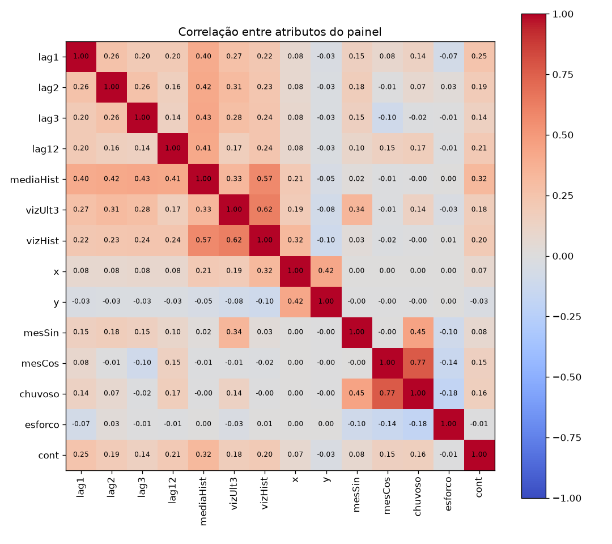

Para o problema multiclasse (nível de registro) foram usados `x`, `y`, `uc`, `mesSin`, `mesCos`, `diaSin`, `diaCos` (dia do ano cíclico), `chuvoso` e `diaSemana`. `ano` foi deixado de fora para não forçar extrapolação no teste temporal.

Nenhum dado externo (chuva, uso do solo, tráfego) foi incorporado; essa é uma das principais sugestões de melhoria (Seção 9).

### 3.4 Os três problemas

| Problema | Unidade | Alvo | Justificativa |
|---|---|---|---|
| **Binário** | célula × mês | 1 se houve ≥ 1 atropelamento silvestre, 0 caso contrário | ocorrência em trecho percorrido (ausência observada); 17,5 % de positivos |
| **Multiclasse** | registro | classe: aves / mamíferos / répteis / anfíbios | evita a raridade extrema das espécies |
| **Regressão** | célula × mês | número de atropelamentos silvestres | intensidade de risco por trecho e período |

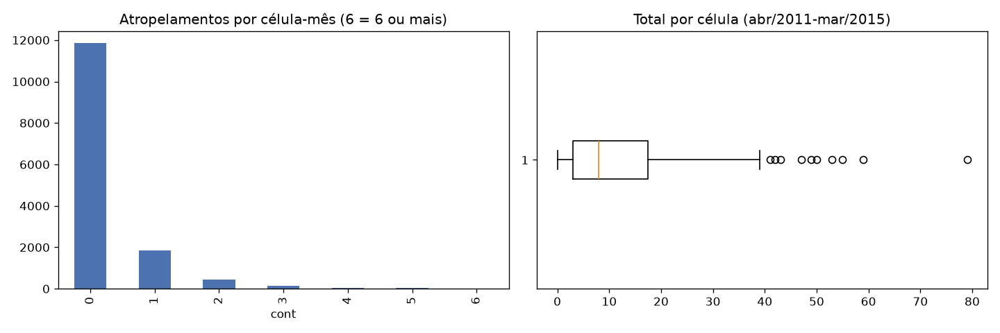

A contagem é muito assimétrica: 82,5 % das células-mês têm zero, a média é 0,25 e o máximo é 13.

---

## 4. Etapa 2 — Pré-processamento e divisão dos dados

### 4.1 Codificação e escala

Foi usado um `ColumnTransformer` ajustado **somente no conjunto de treino**:

- **Contagens** (`lag*`, `mediaHist`, `viz*`): `log1p` seguido de `StandardScaler`. As contagens são muito assimétricas; o `log1p` reduz o peso de valores extremos (hotspots) sem descartá-los e aproxima a distribuição de algo mais simétrico, o que facilita o treinamento da MLP.
- **Numéricos** (`x`, `y`, seno/cosseno, `chuvoso`, `esforco`): `StandardScaler`. A MLP é sensível à escala, porque o gradiente e a inicialização dos pesos assumem entradas de magnitude parecida. Sem padronização, `y` (≈ 8,2·10⁶) dominaria todas as demais entradas.
- **Categóricos nominais** (`uc`, `diaSemana`): **One-Hot Encoding**, com `handle_unknown="ignore"`. Não usamos Label/Ordinal Encoding porque não há ordem natural entre UCs ou dias da semana.
- **Mês e dia do ano**: codificação **cíclica** (seno/cosseno), porque um código ordinal 1–12 colocaria dezembro longe de janeiro.

### 4.2 Divisão dos dados

**Divisão principal (binário e regressão): temporal**, por ano de monitoramento (abr–mar):

| Conjunto | Período | Linhas | % positivos |
|---|---|---|---|
| Treino | abr/2011 – mar/2013 | 7.176 | 18,6 % |
| Validação | abr/2013 – mar/2014 | 3.588 | 17,5 % |
| Teste | abr/2014 – mar/2015 | 3.588 | 15,1 % |

Essa divisão simula o uso real: prever o próximo ano a partir dos anteriores. O teste nunca foi usado para escolher hiperparâmetros, limiares ou épocas — tudo isso usa a validação.

**Divisão principal (multiclasse): aleatória estratificada 60/20/20** (2.651 / 884 / 884), mantendo a proporção das classes.

**Por que uma divisão totalmente aleatória pode ser otimista?** Atropelamentos são espacialmente autocorrelacionados: dois registros a poucos metros um do outro compartilham praticamente os mesmos `x`, `y` e `uc`. Numa divisão aleatória, um registro de teste quase sempre tem um "vizinho gêmeo" no treino, e o modelo pode memorizar coordenadas em vez de aprender padrões generalizáveis. No painel há ainda o vazamento temporal: o alvo de uma célula em um mês de treino é o `lag1` da mesma célula no mês seguinte, que pode estar no teste. Por isso também testamos:

- **Divisão espacial**: blocos de 3 km × 3 km (`GroupShuffleSplit`) — todos os registros de um bloco ficam no mesmo conjunto; 20 % dos blocos vão para teste.
- **Divisão temporal**: treino até mar/2013, validação abr/2013–mar/2014, teste abr/2014–mar/2015.

Os resultados estão nas Seções 5.3 e 5.6.

### 4.3 Tratamento do desbalanceamento

- **Binário (17,5 % positivos):** os modelos foram treinados sem reponderação, e o **limiar de decisão foi escolhido na validação** para maximizar o F1 (o limiar padrão de 0,5 é inadequado — Seção 5.2). A ROC-AUC independe do limiar.
- **Multiclasse:** comparamos a MLP **com pesos balanceados** (`sample_weight` inversamente proporcional à frequência da classe) e **sem pesos**; os modelos clássicos usam `class_weight="balanced"`.

---

## 5. Etapa 3 — Classificação com MLP

### 5.1 Arquitetura e justificativa (MLP base)

| Hiperparâmetro | Binário | Multiclasse | Justificativa |
|---|---|---|---|
| Camadas ocultas | 2 | 2 | uma camada já é um aproximador universal; a segunda permite combinar interações (ex.: histórico × estação) sem exagerar na capacidade para ~7 mil exemplos |
| Neurônios | 64 → 32 | 64 → 32 | formato de funil, ≈ 3 mil parâmetros — razoável para 16 entradas e ~7 mil exemplos |
| Ativação oculta | ReLU | ReLU | evita saturação do gradiente e converge rápido |
| Saída | sigmoide (logística) | softmax | probabilidades para 2 e 4 classes |
| Função de perda | entropia cruzada | entropia cruzada | padrão para classificação probabilística |
| Otimizador | Adam | Adam | taxa adaptativa por parâmetro; robusto sem muito ajuste |
| Taxa de aprendizado | 0,001 | 0,001 | valor padrão do Adam, estável |
| Batch | 128 | 64 | ≈ 56 atualizações por época no binário; o batch menor no multiclasse compensa o conjunto menor (2,6 mil) |
| L2 (alpha) | 1e-4 | 1e-3 | regularização leve |
| Épocas | até 200, early stopping (paciência 20) | até 300, paciência 30 | o treino para quando a métrica de validação não melhora e restaura os melhores pesos |

O treinamento foi feito época a época (`partial_fit`), registrando loss e métrica em treino e validação a cada época, para gerar as curvas exigidas e aplicar o early stopping.

### 5.2 Classificação binária — resultados no teste (abr/2014–mar/2015)

| Modelo | Limiar | Accuracy | Precision | Recall | F1 | ROC-AUC | Tempo (s) |
|---|---|---|---|---|---|---|---|
| **MLP** | 0,28 | 0,789 | 0,366 | 0,534 | 0,434 | **0,775** | 0,79 |
| MLP (limiar 0,5) | 0,50 | 0,841 | 0,436 | 0,169 | 0,244 | 0,775 | 0,79 |
| Regressão Logística | 0,22 | 0,777 | 0,356 | 0,586 | 0,443 | 0,768 | 0,01 |
| Random Forest | 0,26 | 0,776 | 0,355 | 0,593 | **0,444** | 0,773 | 0,39 |
| Gradient Boosting | 0,24 | 0,762 | 0,334 | 0,576 | 0,423 | 0,757 | 0,18 |
| Dummy (sempre "sem atropelamento") | 0,50 | 0,849 | 0 | 0 | 0 | 0,500 | 0,00 |

**Por que a accuracy isolada é inadequada:** prever sempre "sem atropelamento" dá 84,9 % de accuracy, mais do que qualquer modelo real. A própria MLP com limiar 0,5 atinge accuracy de 0,841 mas recall de só 16,9 %, ou seja, perde 83 % das ocorrências. Para detectar hotspots importam o recall e o F1 da classe positiva e a ROC-AUC, que mede a capacidade de **ordenar** trechos por risco.

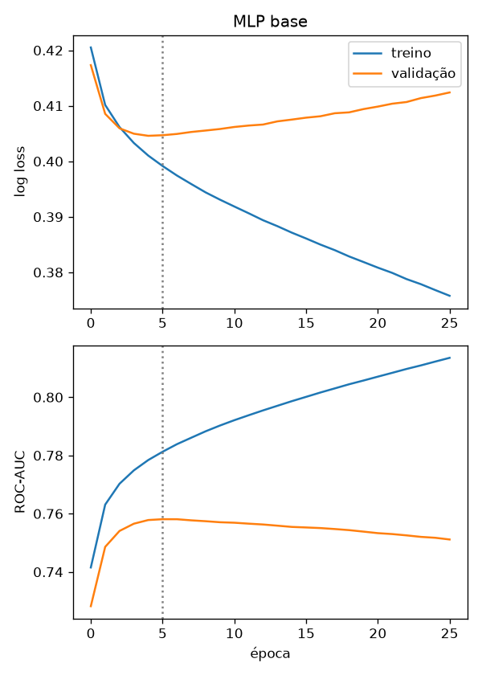

As curvas mostram a ROC-AUC de validação atingindo o máximo logo nas primeiras épocas (melhor na 6ª); depois a loss de validação sobe enquanto a de treino continua caindo — sinal de overfitting rápido, contido pelo early stopping (linha pontilhada).

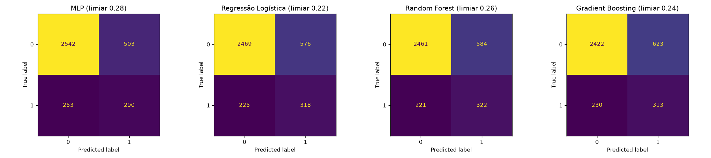
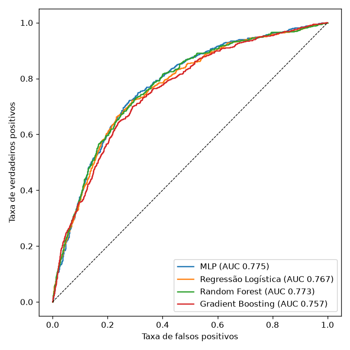

### 5.3 Divisão aleatória × espacial × temporal (binário)

| Divisão | Modelo | F1 | ROC-AUC |
|---|---|---|---|
| Aleatória | MLP | 0,486 | **0,787** |
| Aleatória | Random Forest | 0,471 | 0,787 |
| Espacial (blocos 3 km) | MLP | 0,460 | 0,768 |
| Espacial (blocos 3 km) | Random Forest | 0,456 | 0,761 |
| Temporal | MLP | 0,434 | 0,775 |
| Temporal | Random Forest | 0,444 | 0,773 |

A divisão aleatória dá os números mais altos, o que confirma o otimismo esperado: células-mês vizinhas no espaço e no tempo vazam informação entre treino e teste. As divisões espacial e temporal são mais honestas e perdem ≈ 0,01–0,02 de AUC e 0,03–0,05 de F1. A queda é moderada porque os atributos principais (histórico da célula, sazonalidade) generalizam razoavelmente.

### 5.4 Importância dos atributos (permutação no teste)

| Atributo | Queda de AUC (MLP) | Queda de AUC (RF) |
|---|---|---|
| mediaHist | 0,085 | 0,084 |
| mesCos | 0,030 | 0,019 |
| chuvoso | 0,012 | 0,018 |
| lag1 | 0,009 | 0,006 |
| vizHist | 0,004 | 0,005 |
| lag2 | 0,004 | 0,004 |
| mesSin | 0,007 | 0,004 |
| lag12 | 0,002 | 0,003 |
| uc | 0,005 | −0,001 |
| x, y | ≈ 0 | ≈ 0 |

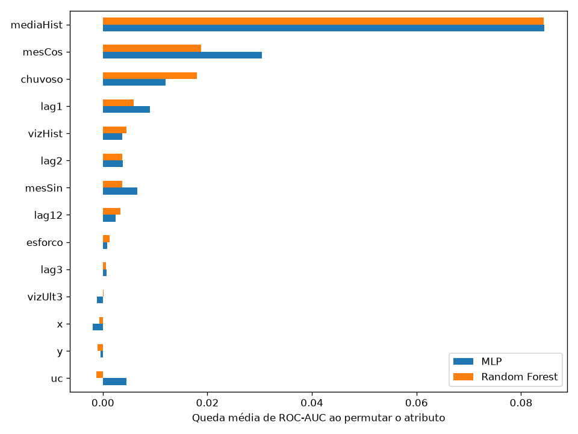

O **histórico da própria célula** (densidade local) é de longe o atributo mais informativo, seguido da **sazonalidade** (mês e estação chuvosa). Coordenadas brutas quase não contribuem quando o histórico está disponível — o histórico já "resume" o local.

### 5.5 Classificação multiclasse — resultados no teste (divisão aleatória estratificada)

| Modelo | Accuracy | Precision macro | Recall macro | F1 macro |
|---|---|---|---|---|
| MLP (pesos balanceados) | 0,437 | 0,336 | 0,397 | 0,322 |
| MLP (sem pesos) | 0,664 | 0,417 | 0,328 | 0,341 |
| Regressão Logística (balanceada) | 0,393 | 0,330 | 0,400 | 0,310 |
| **Random Forest** (balanceado) | 0,584 | 0,407 | **0,462** | **0,425** |
| Gradient Boosting (balanceado) | 0,559 | 0,400 | 0,457 | 0,417 |
| Dummy (sempre "aves") | 0,681 | 0,170 | 0,250 | 0,203 |

Métricas por classe:

| Classe (suporte) | MLP balanceada P / R / F1 | MLP sem pesos P / R / F1 | Random Forest P / R / F1 |
|---|---|---|---|
| anfíbios (55) | 0,17 / 0,56 / 0,26 | 0,38 / 0,16 / 0,23 | 0,31 / 0,56 / 0,40 |
| aves (602) | 0,77 / 0,50 / 0,60 | 0,71 / 0,91 / 0,80 | 0,78 / 0,69 / 0,73 |
| mamíferos (89) | 0,14 / 0,33 / 0,20 | 0,18 / 0,06 / 0,09 | 0,22 / 0,25 / 0,23 |
| répteis (138) | 0,26 / 0,20 / 0,23 | 0,40 / 0,18 / 0,25 | 0,32 / 0,35 / 0,33 |

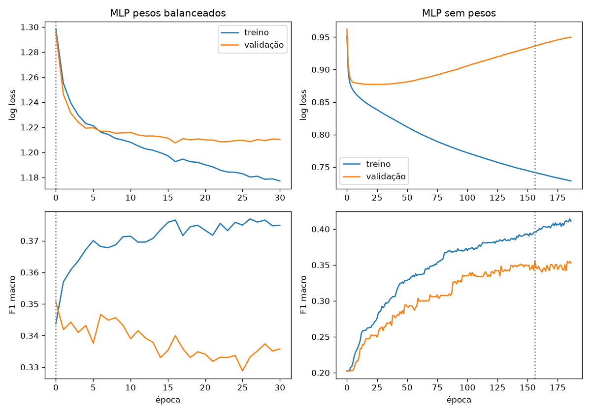
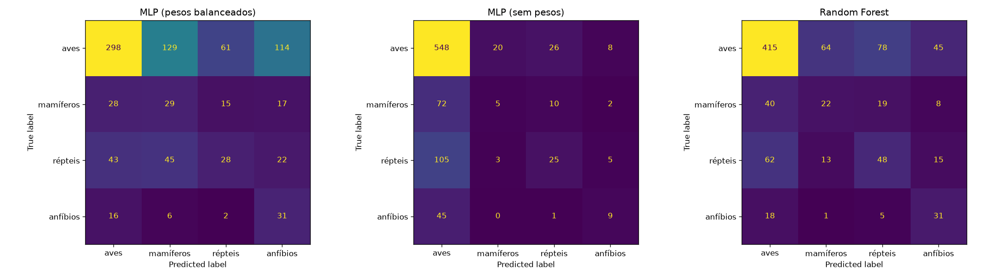

Prever o grupo taxonômico a partir de local e data é um problema **intrinsecamente difícil**: no mesmo trecho e no mesmo dia são atropeladas aves, répteis e mamíferos. O sinal disponível é basicamente sazonal (anfíbios e répteis concentrados na chuva) e espacial (proporções diferentes entre UCs). Todos os modelos superam o Dummy em F1 macro, mas o desempenho é modesto. O Random Forest foi o melhor; a MLP balanceada atinge o pico de F1 de validação logo na primeira época e não melhora depois (o F1 macro em ~880 amostras é ruidoso), enquanto a MLP sem pesos melhora lentamente, mas favorece aves.

### 5.6 Divisões no problema multiclasse

| Divisão | MLP F1 macro | RF F1 macro |
|---|---|---|
| Aleatória | 0,322 | 0,425 |
| Espacial (blocos 3 km) | 0,330 | 0,405 |
| Temporal | 0,304 | 0,343 |

O Random Forest cai de 0,425 (aleatória) para 0,405 (espacial) e 0,343 (temporal): parte do desempenho na divisão aleatória vem de memorizar locais/datas vizinhos. A queda na divisão temporal sugere que a composição por classe varia de ano para ano.

### 5.7 Comparação MLP × métodos clássicos

- **Desempenho:** no binário, MLP, Regressão Logística e Random Forest ficam praticamente empatados (AUC 0,768–0,775; F1 0,434–0,444). Diferenças dessa ordem estão dentro da variação esperada entre sementes. No multiclasse, o Random Forest é claramente superior.
- **Generalização:** a MLP perdeu um pouco menos de AUC que o RF na divisão espacial (0,768 vs. 0,761), mas os dois se comportam de forma muito parecida.
- **Sensibilidade ao pré-processamento:** a MLP depende de padronização, `log1p` e codificação cíclica; sem isso o treinamento diverge ou fica dominado por `y`. Random Forest e Gradient Boosting são invariantes à escala e lidam bem com contagens assimétricas.
- **Custo computacional:** a Regressão Logística treina em 0,01 s; RF em 0,4 s; a MLP em ≈ 0,8 s, mais o custo de escolher a arquitetura (a busca com Optuna levou 51 s). Em tabelas de ~7 mil linhas, o custo é baixo para todos.
- **Interpretação:** a Regressão Logística tem coeficientes diretos; o RF oferece importâncias; a MLP é uma caixa-preta e precisa de métodos como importância por permutação.

---

## 6. Etapa 4 — Regressão com MLP

### 6.1 Definição

O alvo é o **número de atropelamentos silvestres por célula de 500 m por mês**, com os mesmos atributos e a mesma divisão temporal do problema binário. Essa unidade foi escolhida por ser a mais fina em que o esforço é homogêneo, e porque é diretamente útil para a gestão (quantos animais esperar por trecho por mês). Também avaliamos o total por célula no ano de teste (soma das 12 previsões mensais), que é a escala relevante para planejar passagens de fauna.

### 6.2 Arquitetura

MLPRegressor com 2 camadas ocultas (64 → 32), ReLU, saída linear, perda MSE, Adam (lr 0,001), batch 128, L2 alpha 1e-3, até 300 épocas com early stopping (paciência 30, monitorando R² de validação). A escolha espelha a MLP binária, pela mesma razão de capacidade/tamanho de dados. As previsões negativas foram truncadas em 0.

### 6.3 Resultados no teste

| Modelo | MAE | MSE | RMSE | R² (célula-mês) | R² (célula-ano) |
|---|---|---|---|---|---|
| MLP | 0,337 | 0,286 | 0,535 | 0,061 | 0,321 |
| **Regressão Linear** | 0,324 | **0,269** | **0,519** | **0,115** | **0,544** |
| Random Forest | 0,323 | 0,279 | 0,528 | 0,084 | 0,376 |
| Gradient Boosting (perda Poisson) | **0,313** | 0,286 | 0,535 | 0,061 | 0,385 |
| Ingênuo (média histórica da célula) | 0,327 | 0,295 | 0,543 | 0,030 | 0,239 |

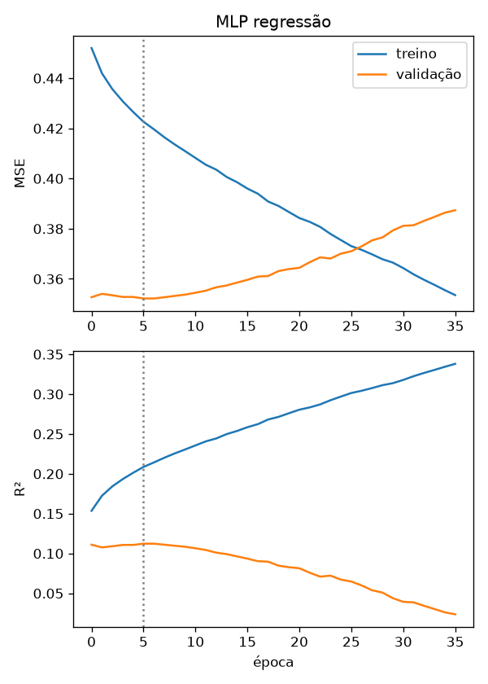
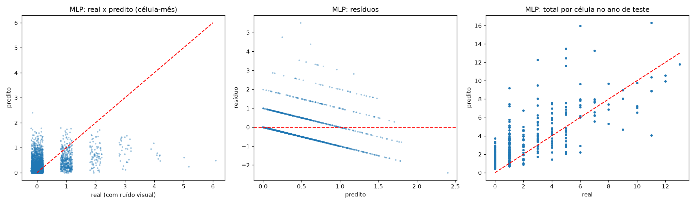

**Análise.** Na escala célula-mês, o R² é baixo para todos os modelos (≤ 0,12): a contagem mensal é dominada por ruído de Poisson (eventos raros — média 0,25), e nenhum modelo consegue prever exatamente *qual* mês terá um atropelamento. As faixas diagonais no gráfico de resíduos são características de alvos inteiros (resíduo = valor real − predito, com real ∈ {0, 1, 2, …}). Ao **agregar por célula no ano de teste**, o R² sobe para 0,32–0,54 e o gráfico real × predito mostra boa concordância: os modelos acertam bem **onde** os atropelamentos se concentram.

**MLP × clássicos.** A Regressão Linear foi a melhor — sinal de que, após `log1p` e padronização, a relação principal (histórico + sazonalidade) é aproximadamente linear, e a capacidade extra da MLP não traz ganho, só variância. A MLP fica próxima de RF e GBM na escala mensal, mas pior na anual. Vantagens da MLP: modela interações não lineares e escala bem para mais atributos (ex.: dados externos). Desvantagens: mais hiperparâmetros, sensível a escala, overfitting rápido (melhor época = 6) e menos interpretável. O Gradient Boosting com perda de Poisson tem o menor MAE, coerente com a natureza de contagem do alvo.

---

## 7. Etapa 5 — Otimização de hiperparâmetros com Optuna

Otimizamos a **MLP binária**, com o objetivo de **maximizar a ROC-AUC de validação** (a métrica que mede a capacidade de ordenar trechos por risco, independente do limiar). Usamos o amostrador TPE (semente 42), **40 trials**, cada um com early stopping (paciência 15). O teste não foi usado.

### 7.1 Espaço de busca

| Hiperparâmetro | Espaço | Justificativa dos limites |
|---|---|---|
| nº de camadas ocultas | 1 – 3 | mais que 3 é desnecessário para 16 atributos e ~7 mil linhas |
| neurônios por camada | 8 – 256 (log) | de uma rede mínima até uma rede que já memoriza o treino (Seção 8) |
| ativação | relu, tanh, logistic | as três disponíveis no scikit-learn |
| otimizador | Adam, SGD | os disponíveis no MLPClassifier (RMSprop/dropout não existem no scikit-learn) |
| momentum (só SGD) | 0,5 – 0,99 | faixa usual |
| learning rate | 1e-4 – 1e-1 (log) | de muito lenta a instável |
| alpha (L2 / weight decay) | 1e-6 – 1e-1 (log) | de praticamente nenhuma a forte regularização |
| batch size | 32, 64, 128, 256, 512 | potências de 2, de ruidoso a quase full-batch |
| nº máximo de épocas | 30 – 200 | o early stopping costuma parar antes |

### 7.2 Resultados

- **Melhor ROC-AUC de validação:** 0,7660 (MLP base: 0,7581)
- **Melhor configuração:** 3 camadas (32 → 26 → 58), ativação logística, Adam, lr = 0,0124, alpha = 0,0038, batch = 64, máx. 50 épocas
- **Tempo total da busca:** 51 s

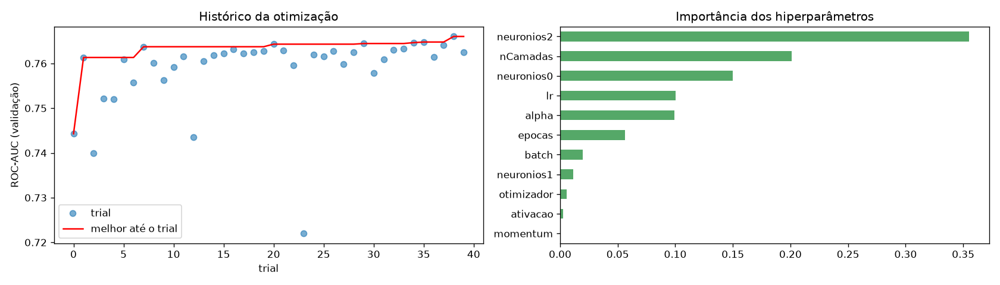

**Importância dos hiperparâmetros (fANOVA):** neurônios da 3ª camada (0,36), nº de camadas (0,20), neurônios da 1ª camada (0,15), learning rate (0,10), alpha (0,10); otimizador e ativação tiveram importância quase nula. Ou seja, **o tamanho/arquitetura e a taxa de aprendizado** foram os fatores mais relevantes.

### 7.3 Original × otimizado (teste)

| Modelo | AUC validação | AUC teste | F1 teste | Recall teste | Épocas | Tempo (s) |
|---|---|---|---|---|---|---|
| MLP base | 0,758 | **0,775** | **0,434** | 0,534 | 26 | 0,79 |
| MLP otimizada | **0,766** | 0,772 | 0,419 | 0,488 | 24 | 1,26 |

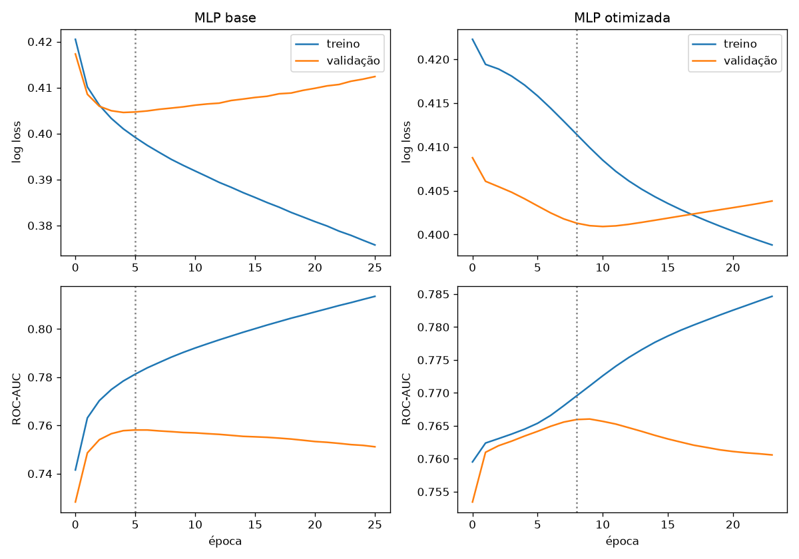

**Discussão.** O Optuna melhorou a AUC de **validação** (+0,008), mas o ganho **não se transferiu ao teste** (−0,003 de AUC, −0,015 de F1). Isso indica que (i) a MLP base já estava perto do teto que os atributos permitem — o limite é a informação disponível, não a arquitetura; (ii) com 40 trials sobre um único conjunto de validação, parte do ganho é ajuste ao ruído da validação (*overfitting* de seleção). O custo de treino subiu ≈ 60 % (rede mais profunda), sem benefício real.

---

## 8. Etapa 6 — Regularização e análise de overfitting

Usamos a MLP binária, com Adam (lr 0,001), batch 64 e até 150 épocas, em cinco configurações:

| Configuração | Épocas | Loss treino | Loss val | AUC treino | AUC val | AUC teste | Gap AUC (tr−val) | F1 teste | Tempo (s) |
|---|---|---|---|---|---|---|---|---|---|
| Grande (256-256-128) sem regularização | 150 | 0,028 | 1,963 | **0,9995** | 0,583 | 0,598 | **0,416** | 0,304 | 109 |
| Grande + L2 (alpha 0,01) | 150 | 0,102 | 1,645 | 0,992 | 0,620 | 0,648 | 0,372 | 0,342 | 117 |
| Grande + early stopping | 17 | 0,397 | 0,406 | 0,787 | 0,759 | **0,775** | 0,028 | **0,434** | 12 |
| Grande + L2 + early stopping | 17 | 0,398 | 0,406 | 0,786 | 0,759 | 0,774 | **0,026** | 0,426 | 12 |
| Reduzida (16 neurônios) | 150 | 0,387 | 0,411 | 0,799 | 0,751 | 0,761 | 0,048 | 0,429 | 4 |

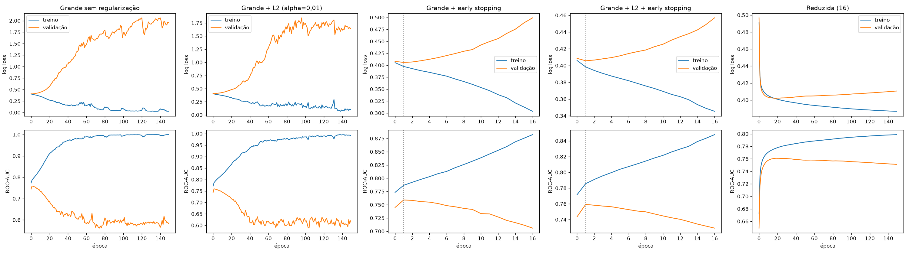

**Respostas:**

1. **A rede apresentou overfitting?** Sim, fortemente. A rede grande sem regularização chega a AUC de treino de 0,9995 (memoriza o treino), enquanto a loss de validação sobe de 0,41 para ≈ 2,0 e a AUC de validação cai de 0,76 para 0,58. A divergência começa por volta da 2ª–5ª época. Não houve underfitting nas configurações razoáveis; a rede reduzida está no limite (gap pequeno, desempenho um pouco menor).
2. **Técnicas usadas:** regularização **L2 (weight decay)**, **early stopping** (paciência 15, restaurando os melhores pesos) e **redução da complexidade** (16 neurônios). Dropout não está disponível no MLPClassifier do scikit-learn.
3. **Houve melhora em dados não vistos?** Sim: a AUC de teste passou de 0,598 (sem regularização) para 0,775 com early stopping (+0,18), e o F1 de 0,30 para 0,43. A L2 sozinha, com alpha = 0,01, ajudou pouco (0,598 → 0,648): a rede ainda é grande demais para ser contida só pela penalização de pesos nesse valor.
4. **Melhor equilíbrio:** **rede grande + L2 + early stopping** tem o menor gap entre treino e validação (0,026) e AUC de teste de 0,774, praticamente igual ao melhor valor (0,775, só early stopping), treinando em 12 s em vez de 110 s. A rede reduzida (16 neurônios) é uma alternativa quase tão boa, muito mais barata e sem precisar de early stopping.

---

## 9. Etapa 7 — Discussão final

**1. Quais atributos têm maior relação com a ocorrência?** O **histórico de atropelamentos da célula** (`mediaHist`) domina: um trecho que já foi hotspot tende a continuar sendo. Em seguida vem a **sazonalidade** (mês e estação chuvosa) e, em menor grau, os atropelamentos recentes (`lag1`, `lag2`) e a densidade nas células vizinhas (`vizHist`). A UC e as coordenadas brutas contribuem pouco quando o histórico está presente.

**2. A MLP foi superior aos métodos tradicionais?** Não de forma consistente. No binário houve empate técnico (AUC 0,775 vs. 0,773 do RF e 0,768 da Regressão Logística). No multiclasse e na regressão, métodos clássicos (Random Forest e Regressão Linear, respectivamente) foram melhores. Em dados tabulares pequenos, com poucos atributos e relações quase lineares, a MLP não tem vantagem.

**3. Maior complexidade resultou em melhor desempenho?** Não. A rede 256-256-128 sem regularização teve o **pior** resultado de teste (AUC 0,60); a rede de 16 neurônios ficou a 0,014 da melhor. A rede de 3 camadas escolhida pelo Optuna também não superou a MLP base de 2 camadas no teste.

**4. Impacto do desbalanceamento?** No binário (15–19 % positivos), o limiar 0,5 levou a recall de só 17 %; ajustar o limiar na validação (≈ 0,25) elevou o recall para 53 % e o F1 de 0,24 para 0,43. Um classificador trivial obtém 85 % de accuracy, o que mostra que a accuracy engana. No multiclasse, a MLP sem pesos favoreceu aves (recall de 91 % para aves, 6 % para mamíferos); com pesos balanceados o recall das minorias subiu (anfíbios 16 % → 56 %, mamíferos 6 % → 33 %), mas à custa das aves e da accuracy global.

**5. Os resultados mudaram após a otimização?** Melhoraram na validação (+0,008 de AUC), mas não no teste. A otimização mostrou que o gargalo é a informação dos atributos, e não a arquitetura.

**6. Os modelos generalizam para regiões/períodos não vistos?** Razoavelmente para o problema binário: com teste em blocos espaciais de 3 km ou no último ano, a AUC fica entre 0,76 e 0,78, só ≈ 0,01–0,02 abaixo da divisão aleatória (que é otimista). No multiclasse a queda temporal é maior (RF: 0,43 → 0,34 de F1 macro). Uma limitação importante: os modelos que dependem do **histórico da célula** não se aplicam diretamente a rodovias **nunca monitoradas** — para isso seriam necessários atributos ambientais externos.

**7. Principais limitações dos dados.**
- Só há registros de presença; a classe negativa precisou ser construída a partir da hipótese de amostragem sistemática.
- Não há a geometria das rodovias; os segmentos foram aproximados por células de 500 m, e trechos da rota sem nenhum registro em 5 anos ficaram de fora.
- Registros duplicados no arquivo e muitos campos `nao_identificado` (espécie 23 %, hora 38 %, sexo 96 %).
- Detectabilidade e remoção de carcaças (por carniceiros ou pela chuva) variam entre classes e estações — anfíbios e aves pequenas são subamostrados.
- Somente 4 trechos/3 UCs, só dias úteis, e 5 anos de dados.
- Não há variáveis de tráfego, velocidade ou paisagem.

**8. Atributos adicionais que poderiam ajudar.** Precipitação e temperatura diárias (INMET), volume de tráfego e velocidade máxima (DER-DF), uso e cobertura do solo (MapBiomas), distância a corpos d'água, matas de galeria e limites de UC, presença de cercas e passagens de fauna, relevo (SRTM), iluminação pública e fase da lua. Com esses atributos, o modelo poderia ser aplicado a rodovias sem histórico.

**9. Como identificar hotspots com o modelo?** Aplicamos a MLP otimizada a todas as células no ano de teste e calculamos a **probabilidade média mensal de atropelamento por célula**:

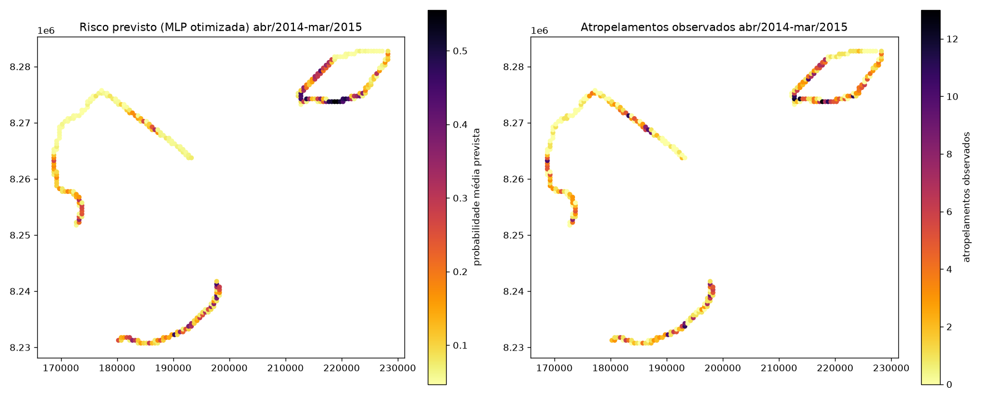

- Correlação de Spearman entre o risco previsto e o total observado por célula: **0,78**.
- Das 30 células do top 10 % de risco previsto, **15** estão também no top 10 % observado.
- Essas 30 células (10 % da malha monitorada) concentraram **28,2 %** de todos os atropelamentos do ano de teste (204 de 724).

Na prática, o modelo serve para **priorizar trechos** para medidas de mitigação (passagens de fauna, cercas-guia, redutores de velocidade, sinalização), concentrando o orçamento nos ≈ 10 % de trechos de maior risco. A previsão mensal ainda permite ações **sazonais** (ex.: campanhas e fiscalização reforçadas na estação chuvosa). A lista ordenada de células está em `resultados/hotspots_previstos.csv`.

---

## 10. Reprodução dos experimentos

```bash
pip install -r requirements.txt
python trabalho.py > resultados/saida.txt
```

- `trabalho.py` — pipeline completo (≈ 6 min em CPU; a semente 42 é fixa em todos os modelos e divisões).
- `ProgramaRodofaunaAtropelada.xlsx` — dados originais exportados do serviço GIS do IBRAM (camada *Programa Rodofauna Atropelada*).
- `figuras/` — todas as figuras do relatório.
- `resultados/` — tabelas CSV de cada experimento, trials do Optuna, ranking de hotspots e a saída completa (`saida.txt`).

Ambiente usado: Python 3.14, scikit-learn 1.9, Optuna 5.0, pandas, matplotlib.
